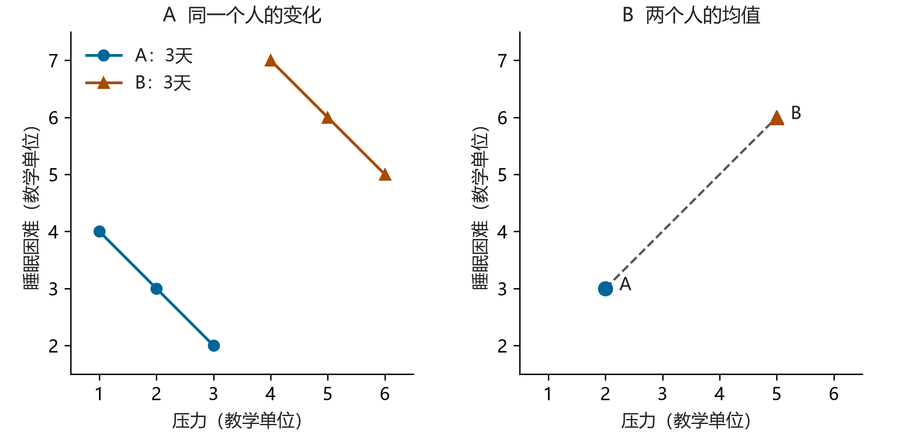

**本章问题：读论文遇到不熟悉的方法时，怎样让 AI 帮我学会，而不只是得到一段解释？**

读方法部分时，你可能认识每个词，却不明白作者为什么要这样分析。请 AI 解释之后，似乎懂了；换一篇论文，又不知道该怎样判断。问题有时出在对话只停留于“请解释”和“解释完了”，没有让你动手比较、作出判断，也没有暴露你究竟卡在哪里。

本章会示范怎样把这样的对话继续下去：告诉 AI 自己会什么，请它举一个能手算的小例子；看不懂时，要求它换一种讲法；觉得懂了，再让它改变条件、出一道新题。我们用“同一个人的变化”和“不同人之间的差异”贯穿讲解。你不必先学会多层模型，可以把这套问法用于自己正在学习的其他方法。

以下数据和示范对话均为教学编写。练习时，可以在千问中粘贴问题和小表，按自己的回答继续追问。

## 先告诉 AI，你会什么、卡在哪里

“给我讲讲多层模型”当然可以作为开头，但范围太大。你可能收到一份包含十几个术语的课程提纲，而眼前的问题仍未解决。不妨从读论文时的一个具体疑问开始：

> 我学过相关和普通回归，还没学过多层模型。这篇研究让同一个人连续多天报告压力和睡眠。我不明白：为什么不能把每天的记录都放在一起，直接算相关？请先解释这个问题，暂时不要介绍完整的多层模型。

如果手边有论文，可以附上相关方法段落，请 AI 先根据原文解释，并把补充知识与作者实际做的分析分开。你的已有知识和具体困惑，比“通俗一点”更能帮助它调整回答。

假设它回答：“重复测量数据同时包含个体内变异与个体间变异，两者需要区分。”这句话可以是正确的，但如果你不懂这两个术语，它还没有帮上忙。接着问：

> 我还是不太明白。请用两个人、每人三天的数据举例，数字要能手算。让我看见：比较不同的人，和比较同一个人的不同日子，为什么可能得到不同答案。

你发给 AI 的这类问题和要求，常被叫作“提示词”。第一轮没讲懂时，指出哪一句不懂、希望用什么来说明，就可以继续。

## 让它举小例子，再用数字追问

假设 AI 给出下面这张表。压力和睡眠困难都是用于演示的指标，数值越高表示程度越高；它们没有对应真实参与者或经过验证的量表。

| 人 | 日 | 压力 | 睡眠困难 |
|---|---:|---:|---:|
| A | 1 | 1 | 4 |
| A | 2 | 2 | 3 |
| A | 3 | 3 | 2 |
| B | 1 | 4 | 7 |
| B | 2 | 5 | 6 |
| B | 3 | 6 | 5 |

这时先别让它一次讲完。你可以要求：“先问我两个问题，等我回答后再解释。”例如：

1. 平均压力较高的人，平均睡眠困难是否较高？
2. 对同一个人而言，压力比自己平常高的日子，睡眠困难是否也较高？

试着分别写出所比较的数字。A 的压力均值为 2，睡眠困难均值为 3；B 的对应均值为 5 和 6。从 A 到 B，两个均值各增加 3，两个均值点之间的斜率是 +1。平均压力较高的 B，平均睡眠困难也较高。

再只看 A：压力从 1 增至 3，睡眠困难从 4 降至 2。B 自己的三天也如此，每个人内部的斜率都是 −1。原来，同一张表中的两种关系可以方向相反。

如果你最初以为两问答案应当一致，可以把自己的想法交给 AI：

> 我原以为“压力越高，睡眠困难越高”对这两种比较都成立。请指出我把哪两个问题混在了一起，并用表中的数字解释。暂时不要增加新的术语。

有帮助的回答应该回到你刚才的误解：第一问比较 A 和 B 的均值，第二问比较 A 自己的三天、再比较 B 自己的三天。前者称为**个体间关系**，后者称为**个体内关系**。如果它只是换一种方式重复定义，你还可以要求：“先只看 A 的三天，我说明白之后再加入 B。”

这样，术语就有了可以对应的例子。Curran 与 Bauer（2011）详细讨论了这两类关系及其在纵向模型中的表达；其中一类的结果，不能直接替代另一类。[方法原文](https://pmc.ncbi.nlm.nih.gov/articles/PMC3059070/)

## 看懂例子后，再请它解释图和公式

表格能手算，图则有助于同时看见两种方向。你可以接着要求：

> 请用同一份数据画两幅图：一幅画每个人三天的记录，连接同一个人的点；另一幅只画两个人的均值。两幅图使用相同的坐标范围，说明每个点代表什么。请保留原始表，让我能核对。

{fig-alt="六行合成数据。A的三点为(1,4)、(2,3)、(3,2)，B为(4,7)、(5,6)、(6,5)，各自斜率均为负1。均值点A为(2,3)、B为(5,6)，均值间斜率为正1。"}

这里的连线帮助我们看清给定数字的关系，没有抽样置信区间，也不能据此推断总体中的关系。检查时，逐点核对图与表是否一致，再看两幅图各自在比较什么。

接下来，公式才有需要解释的对象。你可以问：

> 怎样用一个数表示“今天的压力比自己平常高多少”？请先算出 A 和 B 每天的这个数，再给公式，并把公式里的每个符号对应到表格。

A 的压力均值是 2，因此三个偏离是 −1、0、+1；B 的均值是 5，偏离也是 −1、0、+1。A 的压力 3 和 B 的压力 6 虽然不同，却都比各自均值高 1。“相对自己的平常水平”指的就是这个差。

用符号写出来：

$$
x_{it}^{W}=x_{it}-\bar{x}_i.
$$

$x_{it}$ 是第 $i$ 个人第 $t$ 天的压力，$\bar{x}_i$ 是这个人在观测期内的压力均值；上标 $W$ 提醒我们关注 within-person，也就是个体内部分。如果符号仍然让你困惑，就让 AI 把 A 第三天的数字代进去：$3-2=1$。先把这一行说清楚，再去看一般形式。

把睡眠困难也减去各自均值，两个人得到的都是 +1、0、−1。因此，在这份例子中，压力越高于自己的均值，睡眠困难越低于自己的均值。个体均值告诉我们人与人之间的差异；减去个人均值后，剩下的是每个人相对自身均值的变化。

把六行一起放进普通回归，仍然能算出一个系数，但它同时受到这两类差异的影响。研究问题若是“同一个人压力高于平常时发生什么”，就需要在分析中明确表达这项比较。[数据分析章](07-data-analysis.qmd)会进一步演示相应模型。

## 让它改一个条件，看看你的理解能否跟着变化

看懂一个例子之后，可以请 AI 做一个很小的改动，并暂时不揭示答案：

> 保持每个人三天的变化幅度不变，只把 B 的三个睡眠困难分数都减去 5。请先让我预测个体内、个体间关系分别会怎样变化，再给出新数据核对。

此时 B 的睡眠困难为 2、1、0，均值为 1；A 仍为 4、3、2，均值为 3。B 的平均压力仍比 A 高 3，平均睡眠困难却低了 2，均值点之间的斜率变为 $-2/3$。每个人内部的斜率仍是 −1。

给 B 的每个结果值减去同一个常数，只移动了 B 的整体位置，没有改变 B 各天之间的差值。因此，人与人的比较改变了，每个人内部的变化没有改变。如果你能自己说出这个理由，就比仅仅记住“两类关系可能不同”多理解了一步。

检查例子时也要留意取值是否合理。这里的 0 是允许出现的教学指标值；若你要求用真实的 1–5 量表演示，就不能接受越界的数字，应让 AI 重新构造范围内的例子。

再追问一次：“这个例子有什么不能说明的？”我们的六行数字按天依次变化，压力变化与时间顺序混在了一起，所以它不能识别压力与睡眠困难的独立关系。现实数据若有时间趋势、缺失或不等间隔记录，也需要继续考虑这些问题。减去个人均值不会自动解决所有纵向分析难题。[Curran 与 Bauer 的讨论](https://pmc.ncbi.nlm.nih.gov/articles/PMC3059070/)

AI 的解释如果跳到你尚未学过的模型，可以让它先指出“现有例子少了什么信息”，再带着这个问题查教材或课程。学会识别自己的知识缺口，也比再读一段无法核查的推导有用。

## 请它出一道新题，先别给答案

你可以让 AI 换一个情境，检验自己能否认出相同问题：

> 请围绕刚才的概念出一道新题，换成学习或工作场景。先只给题目。等我说明比较对象和理由后，再检查我的答案；如果有误，先给一个提示，不要立即给完整解答。

例如，两名学生各在三次测验前记录练习时长。甲的时长为 1、2、3 小时，成绩为 8、9、10 分；乙的时长为 4、5、6 小时，成绩为 3、4、5 分。

平均练习更久的学生成绩更低，但每位学生自己练习更久的测验成绩更高。这能否支持“增加练习会降低成绩”？先写出理由，再展开下面的解释。

查看参考解释

甲与乙的均值比较，同时带入了两名学生的其他差异，不能代表同一个学生增加练习后的变化。每位学生内部的正关系，也可能混有测验难度、时间趋势或准备程度。两种关系都可以描述；增加练习的因果效果还需要相应的研究设计和识别依据。

如果你只写了“相关不等于因果”，可以继续请 AI 问你：具体是哪一种比较？可能混入什么因素？这些因素为什么会影响结论？

再换一个概念。下面这张完全合成的表，用来练习理解“交互作用”：

| 任务难度 | 无提示的平均正确数 | 有提示的平均正确数 |
|---|---:|---:|
| 容易 | 8 | 9 |
| 困难 | 3 | 6 |

请计算：提示带来的差异在两种难度下是否一样？如果把“困难且有提示”的均值从 6 改为 4，其他数字不变，你的判断会怎样改变？

查看参考解释

容易任务中，有提示减无提示是 $9-8=1$；困难任务中是 $6-3=3$。两种差异相减为 $3-1=2$。在“正确数”的加法尺度上，提示的差异随难度而变，这是一个交互模式。

把 6 改成 4 后，两种难度下的差异都为 +1，差异之差变为 0。对照这两个例子，可以具体看见“有交互”和“无交互”差在哪里。

题目没有样本量、误差或分配方式，所以这里只能描述给定均值的模式，不能断言总体交互显著，也不能直接赋予因果含义。交互还依赖结果尺度；换成比值或其他尺度，需要重新说明问题。

练习后，别只让 AI 给一个分数。请它指出你哪句话说清了比较、哪一步计算有误、哪项结论超出了题目提供的信息。如果它只说“完全正确”，可以要求它引用你的具体推理并逐项核对；有争议的判断则回到计算、教材或原文。

## 回到自己的论文和方法课

这套做法可以用在不同的学习障碍上。读不懂论文为什么选某个模型，就提供方法段落和研究问题；公式看不懂，就要求把每个符号代入一个小例子；两个概念总是混淆，就让 AI 构造只改变一个条件的对照例子；做题卡住，就要求它每次只给一个提示。

练习结束，用半页写下自己原来混淆了什么、哪个例子使你理解发生变化，以及这个解释适用于什么条件。隔一段时间，再关掉答案做一道新题。能否独立说明理由，可以帮助你发现哪里还没学懂。

准备把学到的方法用于项目时，再请 AI 对照研究问题、数据结构和方法条件，指出还缺哪些判断。把这些问题带到分析讨论中，并在[项目说明](09-project-continuity.qmd)里标明哪些只是学习所得、哪些已经成为分析决定，避免把“听懂了一个例子”直接当作采用方法的依据。

如果 AI 给出的公式、文献或解释互相矛盾，或者无法对应到原文与计算，就把争议点记下来，回查教材、课程或请教方法专家。你可以请它先整理“哪一步对不上、需要查什么”，带着具体问题继续学习。

怎样开始普通对话、使用一份表格，可以参照动态指南的[方法学习操作页](https://How-Tze.github.io/psych-ai-start-guide/chapters/method-learning.html)。本章的练习不要求付费订阅或编程经验。

## 方法来源

Curran, P. J., & Bauer, D. J. (2011). The disaggregation of within-person and between-person effects in longitudinal models of change. *Annual Review of Psychology, 62*, 583–619. [原文与 DOI](https://pmc.ncbi.nlm.nih.gov/articles/PMC3059070/)。该文用于解释两类关系的方法基础；本章数值、反例和练习为另行编写的教学材料。
