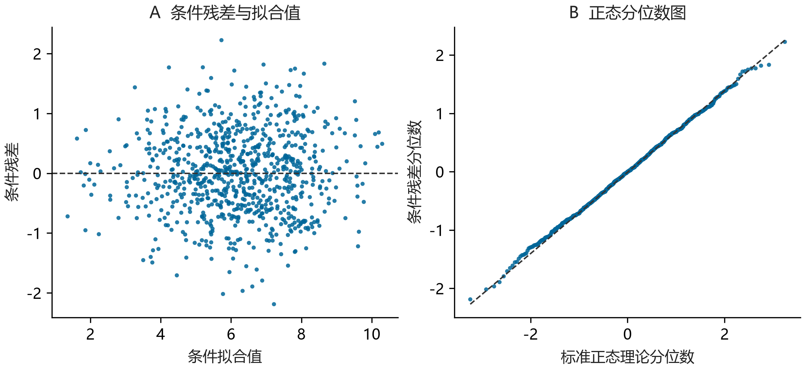

**本章问题：怎样借助 AI 完成一项分析，并且知道代码和结果回答了什么问题？**

拿到一份数据后，很容易直接把文件交给 AI：“帮我分析一下。”它也许会很快给出描述统计、回归和几幅图。但如果你还没说清想比较什么，就很难判断这些分析是否有用。

可以先和 AI 讨论研究问题，请它解释不同分析各自能回答什么；确定之后，再让它写代码、整理输出、帮助你读懂结果。遇到不熟悉的方法时，也可以要求它说明模型如何对应到自己的数据。这样，你在完成分析的同时，有机会补上以前没有理解的环节。

本章有两个例子。先用24行合成问卷，说明怎样让 AI 按研究要求计分和分析；再用60个合成人各14次记录，演示怎样理解纵向模型。所有结果都来自配套脚本的实际运行。这些数据为教学构造，不能作为压力、反刍或睡眠的经验结论。没有编程经验的读者，也可以先跟着表格和解释理解分析过程。

## 写代码之前，先说清想比较什么

“分析压力与睡眠”可能有不同意思：你想知道压力较高的人是否睡得较差，想知道同一个人压力高于平常的日子有什么变化，还是想预测未来一晚的睡眠？这些问题需要的比较不同，判断分析好坏的依据也不同。第一步就是把自己想知道的那个关系说清楚。方法文献常把需要估计的具体对象称为“估计目标”；你可以先用日常语言说明它，再讨论正式表达。

例如，本章问卷练习想问：“在能够计算三个指标的记录中，反刍得分相同时，压力得分不同的记录，其睡眠困难得分平均相差多少？”我们将用线性模型描述这项关系。这里的“反刍得分相同”对应模型中的条件比较，不能据此认为已经隔离出压力的因果作用。

可以这样开始：

> 根据我的研究问题和变量说明，判断我可能想回答哪两种不同问题。请用普通语言说明它们的区别：每一行数据代表什么、要比较谁、现有数据还缺什么。先让我确认要回答的问题，再建议分析步骤。

讨论清楚后，用半页记下分析约定即可：使用哪个文件，变量是什么意思，怎样计分和处理缺失，哪些记录进入分析，使用什么主模型，以及准备比较哪一种替代做法。让 AI 据此写代码。遇到尚未决定的问题，先让它解释选择会带来什么变化，再由你确定。

## 先用24行问卷，检查 AI 是否理解了计分要求

[survey24.csv](../../examples/v1.3/survey24.csv) 包含24个合成记录，每个记录有压力、反刍、睡眠困难各三题，题值为1–5。这些题目专供练习，没有对应一套已经验证的真实量表。

本练习采用的规则是：反刍第3题按 $6-x$ 反向；每个三题指标至少有两题有效才计算有效题均值；三项指标都能计分的记录进入模型。真实量表应依据具体计分规范和缺失处理论证，不能把“至少两题”当作通用心理测量规则。

可以先给 AI 一个容易核对的任务：

> 请先只处理 S01：列出反刍三题原值、反向后的值和最终均值。暂时不要跑回归。等我确认这行计算后，再按相同规则处理全部记录，并列出哪些记录无法计分及原因。

S01 的反刍三题为2、3、1，反向后的第3题为5，所以均值是 $(2+3+5)/3=3.3333$。若 AI 写成 $5-x$，反向值会成为4，均值变为3.0000。代码仍可能顺利运行，但计算已经不符合题目的计分要求。这一行手算能帮你发现只看最终回归表看不出的错误。

再预测样本量。S01–S15 九题完整；S16–S21 各缺一题，仍能形成全部三个指标；S22–S24 分别有某一指标缺两题，无法进入本练习的主模型。因此保留21行。如果在计分前对九题执行“任一缺失即删行”，只会剩15行。

最后检查模型。确认的公式是：

```text
sleep_mean ~ stress_mean + rum_mean
```

文件中的 `age` 仅用于教学，不在确认公式内。加入它会改变条件比较，属于分析选择；即使 AI 说“控制年龄更严谨”，也应先说明为什么要改变目标。年龄列存在并不构成纳入模型的理由。

如果输出与预期不符，可以逐项追问：“为什么只剩15行？”“反向题用了什么公式？”“年龄为什么进入了模型？”这样更容易查出问题发生在筛选、计分还是分析选择，而不用让 AI 把整个脚本重写一遍。

## 再问一次：换一种有理由的规则，结果会怎样

按要求算对之后，还可以讨论另一项问题：结果是否很依赖我们采用的规则？这就是本例所做的敏感性分析。在运行前，我们约定单独比较一种替代做法：把“每项至少两题有效”换成“三题必须完整”，其余计分与模型不变。这样的比较只考察纳入规则改变的影响，不是多重插补，也不能告诉我们真实数据为什么缺失。

[运行脚本](../../examples/v1.3/run_analysis.py)得到以下结果，数值保留三位小数。截距与系数均为这份人工数据的普通最小二乘拟合值：

| 规则 | 纳入记录数 | 截距 | 压力系数 | 反刍系数 |
|---|---:|---:|---:|---:|
| 主规则：每项至少两题 | 21 | 0.838 | 0.364 | 0.343 |
| 比较规则：三题均完整 | 15 | −2.387 | 1.081 | 0.720 |

这张表表明，在本例中规则选择会明显改变系数数值。两组系数同为正，不代表结论“稳健到无需讨论”；大小与所代表的纳入对象也在改变。相反，也不能因为第二行的系数更大就采用第二行。你应保留预先说明的主规则，同时报告替代规则改变了什么。

这里的人工题目有刻意重复的组合，样本也很小，因此表格用于练习计算和报告，不提供总体假设检验。真实研究中，如果缺失与未观察到的结果、参与者状态或测量过程有关，两种完整性规则都未必解决偏差。此时需要依据研究设计进一步分析缺失，而不是让 AI 在“删行”和“填均值”之间随意选一个。

这时，AI 可以继续帮助你理解差异：列出从21行变成15行时少了哪些记录，说明计分和筛选怎样影响分析，再根据实际表格写一段同时报告两种结果的文字。你需要检查，它有没有把“换一种规则后系数变化明显”写成“某个心理机制得到了证明”。

## 换成连续多天的数据，怎样和 AI 讨论模型

假设现在的问题是：“同一个人在压力高于自身平常水平的日子，睡眠困难指标怎样变化？”数据每行是一人一天。你既拥有每个人内部的波动，也拥有人与人的平均差异。

为了看清这两部分，本例生成60个合成人、每人14天，共840行。压力与睡眠困难是无量纲连续教学指标，不是限制在1–5的问卷分数。数据故意设为正的个体间关系、负的个体内关系。我们知道它是怎样生成的，因此可以比较不同模型是否表达了这两类关系；估计出相应方向不能算作发现了心理规律。

初次阅读时，可以先跳过下面的生成细节，继续看模型怎样对应研究问题。需要复现时，再展开核对。

<details>
<summary>查看教学数据的生成过程</summary>

- 每人的平均压力 $\mu_i$ 从均值5、标准差1.5的正态分布生成。
- 每人生成14个均值0、标准差1的正态扰动，再减去这14个数自己的均值，得到 $w_{it}$。
- 每人的随机截距 $u_i$ 标准差为0.8；每行误差 $e_{it}$ 标准差为0.7，均为均值0的正态抽取，并按生成设定相互独立。
- 压力为 $x_{it}=\mu_i+w_{it}$；睡眠困难按以下生成式计算：

$$
\begin{aligned}
y_{it}={}&6+0.8(\mu_i-5)\\
         &-0.6w_{it}+u_i+e_{it}.
\end{aligned}
$$

种子为20261013，生成器为 NumPy `default_rng`（PCG64）。只生成一次完整数据，没有按结果筛选种子，没有缺失、时间趋势或序列相关误差。将14个扰动中心化后，它们的和被约束为0，已不再是彼此独立的原始抽取；模型将它们作为给定的预测变量。这是一次模型教学示范，没有进行仿真功效研究。

</details>

如果不理解为什么要区分两个层次，可以先完成[方法学习章的六行练习](03-method-learning.qmd)。理解之后，把问题交给 AI：

> 数据中每个人有14天记录。我想分别了解“某人压力高于自己平常时”和“平均压力不同的人之间”的关系。请解释模型需要哪两个压力变量，用一个人的记录演示计算。再说明，为什么同一个人的14行不能当成14个不同的人。暂时不要加入更复杂的模型。

先计算每人的观测均值 $\bar{x}_i$，再得到 $x_{it}-\bar{x}_i$。本例要拟合的模型是：

$$
\begin{aligned}
y_{it}={}&\beta_0+\beta_W(x_{it}-\bar{x}_i)\\
         &+\beta_B(\bar{x}_i-5)+u_i+e_{it}.
\end{aligned}
$$

可以请 AI 逐项对应解释：$\beta_W$ 比较一个人相对自身均值的变化；$\beta_B$ 比较平均压力不同的人；减去5只是为截距选择一个明确参考点。$u_i$ 表示这些预测项尚未解释的个人整体差异，同一个人的14行共享这个部分，所以840行不能视为840个独立的人。$e_{it}$ 则表示每次观测剩余的差异。

这叫随机截距模型，因为每个人的起点可以不同。本模型仍为所有人设定同一个个体内斜率。如果你想问“哪些人的日内关联更强”，可以继续与 AI 讨论随机斜率、可能解释斜率差异的变量，以及数据能否支持这些参数。增加参数需要研究问题和数据方面的理由。

个体均值和均值偏离的分解有明确的方法基础；时间趋势、不同测量时点等也可能使简单分解需要扩展。[Curran 与 Bauer（2011）](https://pmc.ncbi.nlm.nih.gov/articles/PMC3059070/) 本例故意使用平衡、完整且无系统时间趋势的数据，让你先掌握一个可运行的起点。

## 实际运行后，三个数各说什么

配套脚本用 statsmodels 的随机截距线性混合模型拟合，采用限制最大似然（REML）。同一脚本还计算把840行直接合并的普通回归，用于比较问题定义。结果如下：

| 模型与项 | 估计值 | 模型给出的95%区间 |
|---|---:|---|
| 直接合并回归：原始压力 | +0.441 | 本教学表不报告忽略重复结构的常规区间 |
| 随机截距模型：个体内压力偏离 | −0.635 | [−0.689, −0.582] |
| 随机截距模型：个体间平均压力 | +0.757 | [+0.632, +0.881] |

后两行是逐项的渐近正态 Wald 95%置信区间，不是观测值范围、预测区间或贝叶斯可信区间。计算依赖指定模型及其假设，不能因为区间没有包含0就认为设计已经排除了混杂。本次固定效应和区间也有有限样本波动，不会与生成参数 −0.6、+0.8 完全一致。

个体内系数 −0.635 的读法是：在本模型中，当一个人的压力比其观测期均值高1单位时，预测的睡眠困难平均低约0.635单位。个体间系数 +0.757 则比较平均压力相差1单位的人。直接合并回归的正数同时受到这两类变化的影响，不能拿来回答已限定的个体内问题。

拿到输出后，不妨让 AI 帮你检查是否读对了系数：

> 请分别用三句话解释上表的三个系数。每句话都必须说明比较单位。然后给出一个会把个体间结果误写成个体内结论的错误句子，让我修改。不要为这些合成数字编造心理机制。

例如，“压力升高使一个人的睡眠更差”就读错了。这份数据的直接合并系数为正，但它混合了两种比较；要回答同一个人的变化，应看个体内系数−0.635，而且不能把它解释为因果作用。读懂结果，首先要知道自己的问题对应表中的哪一行。

## 结果出来以后，继续检查什么

本例模型收敛，没有运行警告；估计的随机截距方差为0.620，残差方差为0.500。条件残差是观测值减去包含估计个体截距的拟合值，其均方根为0.682；相邻日条件残差合并计算的相关为−0.049。这些都是描述性诊断量，并非预设的“通过阈值”。

{fig-alt="左图显示840个观测的条件残差与条件拟合值，水平参考线为零；右图将同一批残差的排序值与标准正态理论分位数比较。图用于观察曲线、扇形和尾部偏离，不给出自动通过结论。"}

看图时先提出具体问题：残差是否随拟合值出现弯曲，提示线性均值结构不足？散布是否随水平改变，提示方差设定需要检查？尾部是否受少数记录影响？时间邻近的记录是否仍有结构？单个总体相关接近0，不能排除不同参与者或不同时段存在不同模式。正态分位数图也只是诊断线索，特别是条件残差经过模型估计，并不等同于直接观察到独立误差。

真实项目还需要检查：记录数是否严重不均，观测时间是否真的等间隔；缺失是否与昨天的压力或睡眠有关；指标的分布与取值范围是否适合线性模型；固定斜率是否掩盖有科学意义的个体差异；个体均值是否因观察天数少而测得很不稳定。模型收敛只说明数值算法达到其判据，这些问题仍然存在。

可以把诊断图和必要的数值一起交给 AI，要求它具体说明下一步：

> 请描述图中实际可见的模式，并把“看见了什么”和“可能是什么原因”分开。对需要检查的问题，提出一个我现在能做的核查步骤。仅凭图无法判断的地方，请说明还需要什么数据。

例如，发现明显时间趋势时，先检查时间变量与理论预期，再讨论怎样把趋势放进模型；发现缺失集中在高负担日时，先整理缺失模式和测量流程。不要把每个异常都处理成删除数据，也不要遍历大量模型，只为找到喜欢的系数。

## 让结果表与文字来自同一次计算

配套脚本保存了计分数据、两种规则的比较表、纵向数据、模型系数、诊断用数据和软件环境。问卷回归还用直接线性代数复核；在本例平衡随机截距结构下，个体内系数也用去均值后的斜率独立核对。检查依据来自实际计算，仅让另一个 AI 表示赞同不能替代它们。

你可以用真实输出写出如下段落：

> 在60个合成人各14次记录的教学数据中，直接合并回归的压力系数为0.441。将观测期个人均值与个人均值偏离同时纳入随机截距模型后，个体内系数为−0.635，95%渐近Wald区间为[−0.689, −0.582]；个体间系数为0.757，区间为[0.632, 0.881]。该数据按预先指定的正个体间、负个体内关系构造，结果用于展示估计目标的区别，不是经验机制或因果结论。

当计分规则或输入改变时，重新运行脚本，先更新表，再更新段落中的对应值。AI 可以查找哪些句子引用旧数字，并提出修改；确认时应回到新表，而不是凭聊天记忆重写一遍。科学代码审查也应兼顾程序与学科含义，Rokem（2024）的原文提供了相关实践建议。[原文](https://journals.plos.org/ploscompbiol/article?id=10.1371/journal.pcbi.1012375)

工作结束时，把采用的规格、实际输入与结果位置一起保留，明确哪些比较已经完成、哪些仍只是计划。[两轮报告例子](../../examples/v1.3/workflow/README.md)继续使用本章问卷结果，展示怎样从已有表生成不同阶段的数字稿；报告生成不等于重新分析。[项目连续性章](09-project-continuity.qmd)进一步说明，变化怎样传递到正文与下一次工作。

## 亲自复现与迁移

配套材料的[运行说明](../../examples/v1.3/analysis-worked-example.md)列出依赖、命令、数据生成过程和全部参考文件。你可以先读表和手算，不必先配置环境；希望练习文件操作时，动态指南的[数据处理教程](https://How-Tze.github.io/psych-ai-start-guide/chapters/data-analysis.html)和[代码代理起步](https://How-Tze.github.io/psych-ai-start-guide/chapters/10-code-agent.html)提供入口。

最后完成三个判断：

1. 主模型压力系数0.364，完整题比较为1.081。能否因为后者更大就改成主规则？不能。要解释规则的科学理由与改变的纳入集合，并保留约定比较，而不是用结果决定规则。
2. 纵向数据有840行，能否说招募了840人？不能。独立的参与者只有60个；不同参数依赖的有效信息也不等于一个简单的总行数。
3. 你的真实研究只收集一次问卷，能否仿照代码生成“个人均值偏离”来检验日内过程？不能。每人只有一行时，观测值等于个人观测均值，偏离全部为0；缺少的时间信息无法由模型补造。

回到自己的项目时，先试着向同事解释：我想比较什么，为什么使用这份数据和这个模型，输出中的哪个数回答了问题，换一种有理由的做法后结果怎样变化。说不清的地方，就是下一次可以与 AI 继续讨论、再查阅方法文献的具体问题。[写作章](08-academic-writing.qmd)会接着说明，怎样把已经核对的表格写成读者能理解的段落。

## 方法与软件来源

Curran, P. J., & Bauer, D. J. (2011). *The disaggregation of within-person and between-person effects in longitudinal models of change*. [原文](https://pmc.ncbi.nlm.nih.gov/articles/PMC3059070/)。

Rokem, A. (2024). *Ten simple rules for scientific code review*. PLOS Computational Biology, 20(9), e1012375. [原文](https://journals.plos.org/ploscompbiol/article?id=10.1371/journal.pcbi.1012375)。

statsmodels. *Linear mixed effects models*. [官方说明](https://www.statsmodels.org/stable/mixed_linear.html)，2026-10-13核对；本次实际运行版本为0.15.0。配套记录保存软件版本，结果以运行值为准。
